# OmniFlow Documentation Diagrams Catalog

This catalog contains all 14 visual diagrams extracted and rendered directly from [PROJECT_DOCUMENTATION.md](./PROJECT_DOCUMENTATION.md).

> **Interactive Gallery**: You can also open [`gallery.html`](./docs/images/gallery.html) in any browser, or visit `http://localhost:5173/docs/images/gallery.html` while the dev server is running!

---

## 1. Traditional Workflow vs. OmniFlow Unified Ecosystem
- **SVG Vector**: [`01-traditional-vs-omniflow-workflow.svg`](./docs/images/01-traditional-vs-omniflow-workflow.svg)
- **PNG Raster**: [`01-traditional-vs-omniflow-workflow.png`](./docs/images/01-traditional-vs-omniflow-workflow.png)


---

## 2. Technology Stack & Reactive Platform Matrix
- **SVG Vector**: [`02-technology-stack-matrix.svg`](./docs/images/02-technology-stack-matrix.svg)
- **PNG Raster**: [`02-technology-stack-matrix.png`](./docs/images/02-technology-stack-matrix.png)


---

## 3. Convex Reactive WebSocket vs. Traditional REST/GraphQL Polling
- **SVG Vector**: [`03-convex-reactive-vs-rest-sequence.svg`](./docs/images/03-convex-reactive-vs-rest-sequence.svg)
- **PNG Raster**: [`03-convex-reactive-vs-rest-sequence.png`](./docs/images/03-convex-reactive-vs-rest-sequence.png)

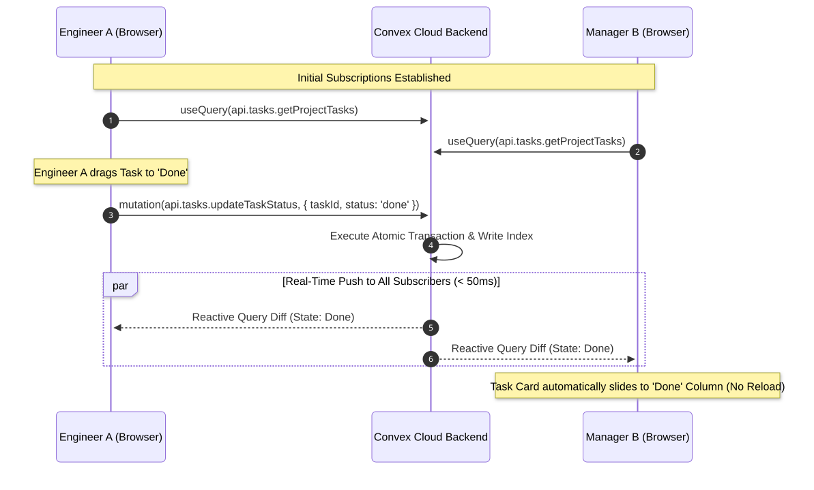

---

## 4. Agile Sprint Planning & Milestone Gantt Schedule
- **SVG Vector**: [`04-sprint-planning-gantt-roadmap.svg`](./docs/images/04-sprint-planning-gantt-roadmap.svg)
- **PNG Raster**: [`04-sprint-planning-gantt-roadmap.png`](./docs/images/04-sprint-planning-gantt-roadmap.png)

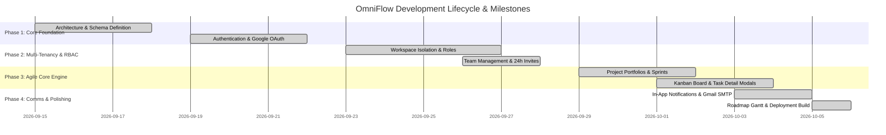

---

## 5. System Context Diagram (DFD Level 0)
- **SVG Vector**: [`05-dfd-level-0-system-context.svg`](./docs/images/05-dfd-level-0-system-context.svg)
- **PNG Raster**: [`05-dfd-level-0-system-context.png`](./docs/images/05-dfd-level-0-system-context.png)


---

## 6. Detailed Data Flow Diagram (DFD Level 1)
- **SVG Vector**: [`06-dfd-level-1-data-flow-diagram.svg`](./docs/images/06-dfd-level-1-data-flow-diagram.svg)
- **PNG Raster**: [`06-dfd-level-1-data-flow-diagram.png`](./docs/images/06-dfd-level-1-data-flow-diagram.png)


---

## 7. System Use Case & Role Interaction Diagram
- **SVG Vector**: [`07-system-use-case-diagram.svg`](./docs/images/07-system-use-case-diagram.svg)
- **PNG Raster**: [`07-system-use-case-diagram.png`](./docs/images/07-system-use-case-diagram.png)


---

## 8. OmniFlow End-to-End System Architecture
- **SVG Vector**: [`08-system-architecture-modules.svg`](./docs/images/08-system-architecture-modules.svg)
- **PNG Raster**: [`08-system-architecture-modules.png`](./docs/images/08-system-architecture-modules.png)


---

## 9. Multi-Tenant Database Schema & Entity Relationship Diagram (ERD)
- **SVG Vector**: [`09-database-schema-erd.svg`](./docs/images/09-database-schema-erd.svg)
- **PNG Raster**: [`09-database-schema-erd.png`](./docs/images/09-database-schema-erd.png)


---

## 10. Workspace Authorization & Context Mount Flow
- **SVG Vector**: [`10-workspace-authorization-sequence.svg`](./docs/images/10-workspace-authorization-sequence.svg)
- **PNG Raster**: [`10-workspace-authorization-sequence.png`](./docs/images/10-workspace-authorization-sequence.png)

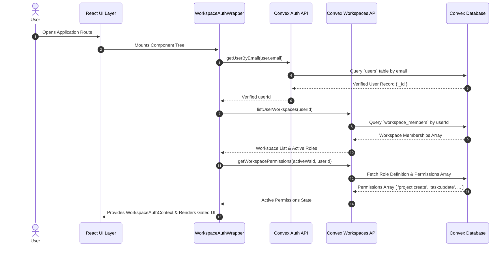

---

## 11. Transactional Gmail SMTP Invitation Sequence
- **SVG Vector**: [`11-gmail-smtp-invitation-sequence.svg`](./docs/images/11-gmail-smtp-invitation-sequence.svg)
- **PNG Raster**: [`11-gmail-smtp-invitation-sequence.png`](./docs/images/11-gmail-smtp-invitation-sequence.png)

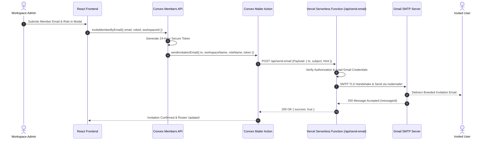

---

## 12. Agile Sprint Lifecycle State Machine
- **SVG Vector**: [`12-sprint-lifecycle-state-machine.svg`](./docs/images/12-sprint-lifecycle-state-machine.svg)
- **PNG Raster**: [`12-sprint-lifecycle-state-machine.png`](./docs/images/12-sprint-lifecycle-state-machine.png)


---

## 13. Kanban Task Status Lifecycle State Machine
- **SVG Vector**: [`13-task-status-lifecycle-state-machine.svg`](./docs/images/13-task-status-lifecycle-state-machine.svg)
- **PNG Raster**: [`13-task-status-lifecycle-state-machine.png`](./docs/images/13-task-status-lifecycle-state-machine.png)


---

## 14. User Interface Design & Navigation Architecture
- **SVG Vector**: [`14-ui-navigation-architecture.svg`](./docs/images/14-ui-navigation-architecture.svg)
- **PNG Raster**: [`14-ui-navigation-architecture.png`](./docs/images/14-ui-navigation-architecture.png)


---

